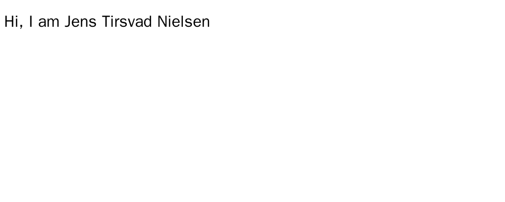

# 🚀 056 My Personal Site

Day 56 of Udemy's "100 Days of Code: The Complete Python Pro Bootcamp": a personal CV website served by Flask, built in three lecture steps, for course participants and visitors who want a small, runnable example.

## 📚 Table of Contents

- [Overview](#-overview)
- [Requirements](#-requirements)
- [Setup](#-setup)
- [Run](#-run)
- [Tests](#-tests)
- [License](#-license)
- [Links](#-links)
- [Appendix: Project documents](#-appendix-project-documents)

## 🧭 Overview

The repository follows the assignment's three lecture steps. Each step is one milestone, one pull request and one screenshot:

1. **Render HTML** with Flask: the route `/` renders `templates/index.html` with `render_template`.
2. **Serve static files**: a CSS file in `static/` changes the page background.
3. **Use a website template**: the course's CV template, filled with the author's own content.

| Folder | What it holds |
| --- | --- |
| `src/personal_site/` | The Flask application, split into `domain`, `application`, `infrastructure` and `presentation` layers; `constants.py` holds every constant |
| `tests/` | `pytest` tests: `unit`, `integration` and `e2e` |
| `docs/` | Project documents, wiki pages and screenshots |
| `Doxyfile` | Configuration for the Doxygen documentation of the source |

## 📋 Requirements

- Python 3.13 or later, to run the code (`requires-python = ">=3.13"`).
- Flask, installed by `pip`; it is the only runtime dependency.
- `pytest` to run the tests (installed with the `test` extra).
- Optional: Doxygen for the source documentation, Docker to retake the screenshots.

## 🛠️ Setup

Create a local virtual environment named `.venv` in the project folder, activate it, upgrade `pip` and install the project with its test tools.

Windows (PowerShell):

```powershell
python -m venv .venv
.venv\Scripts\Activate.ps1
python -m pip install --upgrade pip
python -m pip install -e ".[test]"
```

Linux and macOS:

```bash
python3 -m venv .venv
source .venv/bin/activate
python -m pip install --upgrade pip
python -m pip install -e ".[test]"
```

Leave the environment with `deactivate`. Use `".[dev]"` instead of `".[test]"` to also install `ruff` and `mypy`.

## ▶️ Run

With the virtual environment active, start the development server (debug mode, auto reload) and open <http://127.0.0.1:5000/>:

```bash
python -m personal_site
```

Or use Flask's own command:

```bash
flask --app personal_site.presentation.server run --debug
```

### 📸 Lecture steps

**Lecture 1: render HTML.** The route `/` renders `templates/index.html` with `render_template`. HTML files must live in a folder called `templates`.



The screenshots are taken in Docker, never on the host desktop (headless Chromium, see `framework/process/gui-testing.md`). To retake one, start Docker and run:

```bash
bash scripts/take-screenshot.sh lecture-1-render-html.png / 1000 400
```

## 🧪 Tests

With the virtual environment active:

```bash
python -m pytest
```

Generate the source documentation with `doxygen Doxyfile`; it writes to `docs/doxygen/` (ignored by git).

## 📄 License

GNU Affero General Public License v3.0, see [LICENSE][license].

## 🔗 Links

- [Repository][repository]
- [Documentation][documentation]
- [Issue tracker][issues]

## 📎 Appendix: Project documents

The documents a newcomer needs, in reading order.

| Document | What it tells you |
| --- | --- |
| [Business Case][BC-001] | Why the project exists, its scope and success criteria |
| [Stakeholder Analysis][SA-001] | Who is involved; the stakeholder IDs used for owners and reviewers |
| [Project Plan][PP-001] | The gateways and their schedule |
| [Milestones][milestones] | One document per gateway: Go/No-Go criteria and tasks |
| [Artifact registry][registry] | Where each artifact type lives, the next version, the PO language and domain |
| [Traceability matrix][TM-001] | How the artifacts link and when each was last reviewed |
| [Framework README][framework-readme] | The framework this project uses |
| [Framework changelog][framework-changelog] | What changed in each framework release |

---

[license]: ./LICENSE
[repository]: https://git.tirsystem.com/Tirsvad-Udemy-100-days-of-code/056-my-personal-site
[documentation]: https://git.tirsystem.com/Tirsvad-Udemy-100-days-of-code/056-my-personal-site/wiki
[issues]: https://git.tirsystem.com/Tirsvad-Udemy-100-days-of-code/056-my-personal-site/issues
[BC-001]: ./docs/business-case.md
[SA-001]: ./docs/stakeholder-analysis.md
[PP-001]: ./docs/project-plan.md
[milestones]: ./docs/milestones/
[registry]: ./docs/artifact-registry.md
[TM-001]: ./docs/sqa/traceability-matrix.md
[framework-readme]: ./framework/README.md
[framework-changelog]: ./framework/CHANGELOG.md
