# Project Plan: Personal Site

## Metadata
| Key | Value |
| --- | --- |
| ID | PP-001 |
| CrossReference | [BC-001], [SA-001], [MIL-001], [MIL-002], [MIL-003], [MIL-004], [MIL-005] |
| Language | en |
| Domain | it |

## Version History
| Date | Status | Author | Reviewer | Change | Commit |
| --- | --- | --- | --- | --- | --- |
| 2026-11-09 | Accepted | Claude for S01 | AI as stand-in for S01 | Initial version | [d32718e] |

---

## Purpose

This plan schedules the five gateways of the personal site project over the one-week constraint of [BC-001], from 2026-11-09 to 2026-11-13. Each gateway is one milestone document and one pull request.

## Planning Assumptions

- Week 1 starts 2026-11-09; the plan ends by 2026-11-13, per the Business Case constraint.
- Phase length: one day per gateway, because each lecture step is small.
- The communication cadence of [SA-001] applies: S01 receives the final summary; the README and wiki are updated per milestone.
- The baseline documents (Business Case, Stakeholder Analysis, Project Plan, milestones) are merged in one pull request before any code.

## Gateway Schedule

| Gateway | Document | Window | Decision date | Owner | Stories | Main deliverable | Milestone |
| --- | --- | --- | --- | --- | --- | --- | --- |
| G1 Project setup | [MIL-001] | 2026-11-09 | 2026-11-09 | S01 | none (technical tasks) | Project skeleton | |
| G2 Lecture 1 | [MIL-002] | 2026-11-10 | 2026-11-10 | S01 | none (technical tasks) | Rendered `index.html` | |
| G3 Lecture 2 | [MIL-003] | 2026-11-11 | 2026-11-11 | S01 | none (technical tasks) | Static CSS served | |
| G4 Lecture 3 | [MIL-004] | 2026-11-12 | 2026-11-12 | S01 | none (technical tasks) | Personal CV site | |
| G5 Documentation | [MIL-005] | 2026-11-13 | 2026-11-13 | S01 | none (technical tasks) | README, wiki, metadata | |

```plantuml
@startgantt
Project starts 2026-11-09
[G1 Project setup] starts 2026-11-09 and ends 2026-11-09
[G2 Lecture 1] starts 2026-11-10 and ends 2026-11-10
[G3 Lecture 2] starts 2026-11-11 and ends 2026-11-11
[G4 Lecture 3] starts 2026-11-12 and ends 2026-11-12
[G5 Documentation] starts 2026-11-13 and ends 2026-11-13
[G1 Go/No-Go] happens 2026-11-09
[G2 Go/No-Go] happens 2026-11-10
[G3 Go/No-Go] happens 2026-11-11
[G4 Go/No-Go] happens 2026-11-12
[G5 Go/No-Go] happens 2026-11-13
@endgantt
```



## Scope Coverage

| Business Case scope item | Gateway |
| --- | --- |
| Flask application, tests, constants | G1, G2 |
| Templates and static files for the lecture steps | G2, G3, G4 |
| Participant's photo and personal information | G4 |
| `pyproject.toml`, `.gitignore`, Doxyfile, README | G1, G5 |
| Wiki in three languages with screenshots | G5 |
| Repository description and topics | G5 |

## Dependencies

```
G1 → G2 → G3 → G4 → G5
```

A No-Go on a gateway stops the chain at that gateway; later dates move by the days needed to fix it, and the one-week constraint is then reviewed. S01 decides any move of the end date.

## Plan Risks

| Risk | Impact | Mitigation |
| --- | --- | --- |
| The CV template download has expired | G4 slips | Use the public demo page as the source; stop and report if neither is available |
| Docker is not running | Screenshots cannot be made | Stop and report; never fall back to the host desktop |
| Reviews by a stand-in are challenged by S01 | Rework of documents | Keep every review record explicit about the stand-in and not independent |

## Open Issues

- The licence of the CV template is not stated by the course; MIL-004 records what is found.
- The Milestone links in the Gateway Schedule are filled after `sync-project.sh --apply`.

---

[BC-001]: ./business-case.md
[SA-001]: ./stakeholder-analysis.md
[MIL-001]: ./milestones/mil-001-project-setup.md
[MIL-002]: ./milestones/mil-002-lecture-1-render-html.md
[MIL-003]: ./milestones/mil-003-lecture-2-static-files.md
[MIL-004]: ./milestones/mil-004-lecture-3-cv-site.md
[MIL-005]: ./milestones/mil-005-documentation-and-wiki.md
[d32718e]: https://git.tirsystem.com/Tirsvad-Udemy-100-days-of-code/056-my-personal-site/commit/d32718e43960fc70996a1bc58979d71aa42046ef
